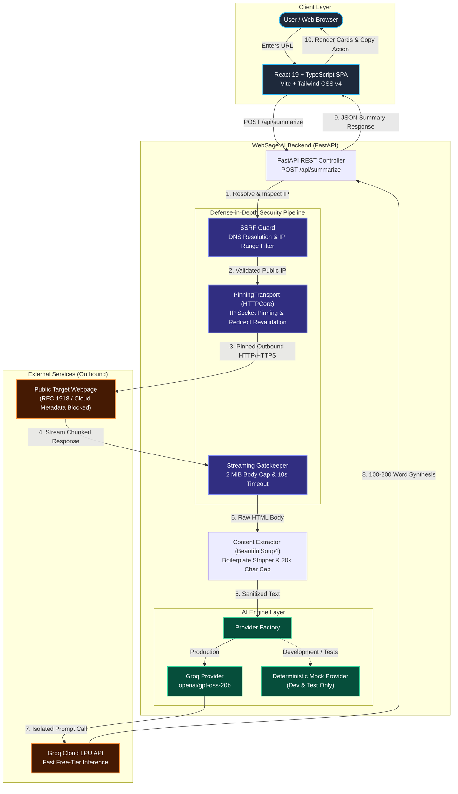
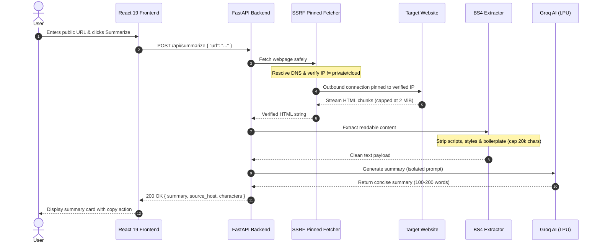

<div align="center">

# 🌐 WebSage AI
### *High-Speed, Security-Hardened Webpage Summarizer Powered by Groq LPU*

[](LICENSE)
[](https://www.python.org/)
[](https://fastapi.tiangolo.com/)
[](https://react.dev/)
[](https://www.typescriptlang.org/)
[](https://vitejs.dev/)
[](https://tailwindcss.com/)
[](https://groq.com/)
[](https://ai.google.dev/)
[](#-automated-testing--verification)
[](#-zero-cost-budget-guarantee)

<p align="center">
  <b>Transform long articles, news reports, and documentation into crisp, objective 100–200 word syntheses in seconds.</b><br/>
  Engineered with enterprise-grade SSRF defense, DNS rebinding socket pinning, and a hard ₹0 operating budget.
</p>

[Explore Docs](docs/requirements.md) • [Report Bug](https://github.com/shlok926/WebSage-AI/issues) • [Security Policy](SECURITY.md) • [Contributing](CONTRIBUTING.md)

</div>

---

## 📑 Table of Contents

- [Overview](#-overview)
- [Key Features](#-key-features)
- [System Architecture](#-system-architecture)
  - [Component Architecture](#component-architecture)
  - [Request Execution Flow](#request-execution-flow)
- [Security Engineering Baseline](#-security-engineering-baseline)
- [Zero-Cost Budget Guarantee](#-zero-cost-budget-guarantee)
- [Tech Stack](#-tech-stack)
- [Repository Structure](#-repository-structure)
- [Local Installation & Setup](#-local-installation--setup)
- [Running the Application](#-running-the-application)
- [Automated Testing & Verification](#-automated-testing--verification)
- [API Contract & Specifications](#-api-contract--specifications)
- [Deployment Guide](#-deployment-guide)
- [Contributing & Community](#-contributing--community)
- [License](#-license)

---

## 🌟 Overview

The modern web is inundated with thousands of words of dense prose wrapped in boilerplate layouts, ads, and trackers. Reading an entire article or documentation page just to extract a few key takeaways is time-consuming and inefficient.

**WebSage AI** solves this problem by providing an instantaneous, security-first summarization pipeline:
1. **Validates & Pins Outbound Traffic:** Blocks malicious SSRF attempts and locks connections to pre-checked public IP addresses.
2. **Scrapes & Purifies Content:** Parses the HTML document, discards navigational clutter, tracking tags, and scripts, leaving only readable article prose.
3. **High-Speed AI Synthesis:** Feeds clean content into an isolated Groq LPU prompt (`openai/gpt-oss-20b`) delivering high-density, factual summaries in under 3 seconds.

---

## ✨ Key Features

* 🛡️ **Hardened SSRF Protection:** Pre-request DNS resolution rejecting RFC 1918 private subnets, loopbacks, link-local cloud metadata (`169.254.169.254`), multicast, and CGNAT (`100.64.0.0/10`).
* 🔒 **DNS Rebinding (TOCTOU) Defense:** Socket connection pinning binds the TCP socket exclusively to the pre-validated public IP address, thwarting DNS race attacks without compromising standard TLS validation or SNI.
* 🛑 **2 MiB Streaming Cap:** Aborts oversized downloads mid-stream to defend backend workers against HTTP decompression bombs and memory exhaustion.
* 🔄 **Safe Redirect Traversal:** Enforces a hard limit of 3 redirects, validating the target IP afresh at every hop before opening an outbound socket.
* 🧹 **Intelligent Content Extraction:** BeautifulSoup4 strips boilerplate elements (`<nav>`, `<header>`, `<footer>`, `<aside>`, `<script>`, `<style>`) and bounds text payload to 20,000 characters.
* ⚡ **Lightning-Fast AI Inference:** Groq LPU API produces crisp 100–200 word syntheses with minimal latency.
* 🧪 **Zero-API Dev Experience:** Deterministic mock AI provider enables full development and offline testing with 0 API tokens consumed.
* 🎨 **Refined Dark Interface:** Modern React 19 SPA with Tailwind CSS v4, Lucide icons, keyboard shortcuts, and one-click clipboard copying.

---

## 🏛️ System Architecture

### Component Architecture



---

### Request Execution Flow



---

## 🛡️ Security Engineering Baseline

Web-crawling applications are intrinsically susceptible to network traversal attacks. WebSage AI enforces strict controls at every layer:

| Threat Vector | Attack Scenario | WebSage AI Defense |
| :--- | :--- | :--- |
| **SSRF (Internal Network)** | Target URL points to `192.168.1.1` or `10.0.0.1` | **Rejected.** DNS pre-resolution checks all IPs against `ipaddress.is_global`. |
| **Cloud Metadata Theft** | Attacker probes `http://169.254.169.254/latest/meta-data` | **Rejected.** Link-local addresses (`169.254.0.0/16`) are blocked before socket creation. |
| **DNS Rebinding (TOCTOU)** | Domain resolves to public IP on check, but switches to `127.0.0.1` on connect | **Mitigated.** `PinningTransport` pins the socket directly to the validated IP, preserving SNI and TLS validation. |
| **Redirect Poisoning** | Public URL issues a `302 Redirect` to internal admin panel | **Mitigated.** Automatic redirects are disabled. Targets are re-validated at each hop (max 3). |
| **Decompression Bomb** | Server returns an infinite or multi-gigabyte body | **Mitigated.** Streaming reader enforces a hard **2 MiB cap** and terminates connection immediately. |
| **Prompt Injection** | Scraped page contains malicious instructions (e.g. *"Ignore all instructions..."*) | **Mitigated.** Scraped content is isolated within explicit content tags; system prompt instructs LLM to treat content strictly as untrusted reference data. |
| **Credential Leakage** | API keys or server stack traces printed in logs or client errors | **Mitigated.** Strict exception sanitization; API keys exist only in backend memory and are never sent to the client. |

---

## 💰 Zero-Cost Budget Guarantee

WebSage AI is purpose-built to operate indefinitely at **₹0 mandatory cost**:

* **AI Inference:** Powered by Groq's official Free Tier using `openai/gpt-oss-20b` (30 Requests/Min, 8,000 Tokens/Min, 200,000 Tokens/Day). No credit card required.
* **Backend Hosting:** Runs on Render Free Web Services (750 free instance hours/month) or Railway/Koyeb.
* **Frontend Hosting:** Runs on Vercel Hobby Tier or Cloudflare Pages (100 GB/month bandwidth free).
* **Development & CI:** Fully functional offline mode using `USE_MOCK_AI=true` for zero token burn.

---

## 🛠️ Tech Stack

### Backend
* **Python 3.10+** (Async runtime)
* **FastAPI** (REST API framework with OpenAPI schema)
* **Pydantic v2 & Pydantic-Settings** (Strict request/response validation)
* **HTTPX & HTTPCore** (Async HTTP client with custom socket pinning)
* **BeautifulSoup4** (HTML sanitization and text extraction)
* **Groq Python SDK** (High-speed LPU inference)
* **Pytest & Pytest-Asyncio** (Automated test suite)

### Frontend
* **React 19** (Concurrent UI library)
* **TypeScript 5** (Strict type safety)
* **Vite 6** (Next-gen frontend tooling and bundler)
* **Tailwind CSS v4** (Utility-first styling with modern dark theme)
* **Lucide React** (Clean, accessible SVG iconography)

---

## 📂 Repository Structure

```text
WebSage-AI/
├── .gitignore                      # Git exclusion rules
├── CODE_OF_CONDUCT.md              # Contributor Covenant v2.1
├── CONTRIBUTING.md                  # Development guidelines & PR process
├── LICENSE                         # MIT License
├── README.md                       # Complete project documentation
├── SECURITY.md                     # Vulnerability reporting & security baseline
│
├── docs/                           # Frozen Requirements v1.2 Specifications
│   ├── acceptance-criteria.md      # Observable acceptance verification
│   ├── requirements.md             # Functional requirements & API spec
│   └── security.md                 # Security baseline & threat models
│
├── backend/                        # FastAPI Application
│   ├── .env.example                # Template environment variables
│   ├── pytest.ini                  # Pytest configuration
│   ├── requirements.txt            # Python dependencies
│   ├── app/
│   │   ├── __init__.py
│   │   ├── config.py               # Pydantic BaseSettings config
│   │   ├── main.py                 # FastAPI application routes & middleware
│   │   ├── models.py               # Pydantic schemas (Request/Response/Errors)
│   │   └── services/
│   │       ├── extractor.py        # BeautifulSoup4 HTML text parser
│   │       ├── fetcher.py          # SSRF-hardened pinned HTTPX fetcher
│   │       └── ai/
│   │           ├── base.py         # Abstract AI provider interface
│   │           ├── factory.py      # Provider factory with production guard
│   │           ├── gemini_provider.py # Google Gemini SDK implementation
│   │           ├── groq_provider.py# Groq SDK implementation
│   │           └── mock_provider.py# Deterministic offline mock provider
│   └── tests/                      # Automated Test Suite (35 tests)
│       ├── conftest.py             # Pytest fixtures & async setup
│       ├── test_ai_provider.py     # AI provider tests (mock, Groq, Gemini)
│       ├── test_api_e2e.py         # End-to-end FastAPI endpoint tests
│       ├── test_extractor.py       # HTML parsing & truncation tests
│       ├── test_ssrf_fetcher.py    # SSRF & connection pinning tests
│       └── test_validation.py      # URL & IP validation tests
│
└── frontend/                       # React 19 Single Page Application
    ├── index.html                  # HTML5 entry point
    ├── package.json                # NPM dependencies & scripts
    ├── tsconfig.json               # TypeScript configuration
    ├── vite.config.ts              # Vite configuration & dev proxy
    └── src/
        ├── App.tsx                 # Root application component
        ├── main.tsx                # React entry point
        ├── index.css               # Tailwind CSS setup & global styles
        ├── components/
        │   ├── Header.tsx          # Brand header & GitHub link
        │   ├── UrlForm.tsx         # URL input form with validation
        │   ├── SummaryCard.tsx     # Result display with copy-to-clipboard
        │   └── ErrorBanner.tsx     # Sanitized error display
        └── services/
            └── api.ts              # Typed API client for FastAPI
```

---

## 🚀 Local Installation & Setup

### Prerequisites
* **Python:** Version `3.10` or higher
* **Node.js:** Version `18.0` or higher & **npm** `9.0`+
* **Git:** Version `2.x`

### 1. Clone the Repository
```bash
git clone https://github.com/shlok926/WebSage-AI.git
cd WebSage-AI
```

### 2. Backend Setup
```bash
cd backend

# Create virtual environment
python -m venv venv

# Activate virtual environment
# Windows:
venv\Scripts\activate
# Linux/macOS:
source venv/bin/activate

# Install dependencies
pip install -r requirements.txt

# Create environment file from template
# Linux/macOS:
cp .env.example .env
# Windows (PowerShell):
Copy-Item .env.example .env
```

### 3. AI Provider Configuration (`backend/.env`)

Configure your preferred AI provider in `backend/.env`:

#### Option A: Using Google Gemini (Active Alternative)
1. In `backend/.env`, set `AI_PROVIDER=gemini`.
2. Insert your Google AI Studio API key:
   ```env
   AI_PROVIDER=gemini
   GEMINI_API_KEY=your_actual_gemini_api_key_here
   GEMINI_MODEL=gemini-2.5-flash
   USE_MOCK_AI=false
   ```

#### Option B: Switching to Groq (When Key is Available)
1. In `backend/.env`, set `AI_PROVIDER=groq`.
2. Insert your Groq API key:
   ```env
   AI_PROVIDER=groq
   GROQ_API_KEY=your_actual_groq_api_key_here
   GROQ_MODEL=openai/gpt-oss-20b
   USE_MOCK_AI=false
   ```

#### Option C: Offline / Mock Mode (Zero API Calls)
Leave `USE_MOCK_AI=true` to test the full frontend and backend pipeline offline without any external API keys.

---

### 4. Frontend Setup
```bash
cd ../frontend

# Install dependencies
npm install
```

---

## 💻 Running the Application

### 1. Launch Backend Server
```bash
cd backend
python -m uvicorn app.main:app --host 127.0.0.1 --port 8000 --reload
```
* **API Server:** `http://127.0.0.1:8000`
* **Swagger Documentation:** `http://127.0.0.1:8000/docs`
* **Health Check:** `http://127.0.0.1:8000/health`

### 2. Live API Smoke Test (Safe & Non-Exposing)
To verify that your configured provider generates live summaries without logging or exposing your API key in terminal outputs:
```bash
curl -X POST http://127.0.0.1:8000/api/summarize \
  -H "Content-Type: application/json" \
  -d '{"url": "https://en.wikipedia.org/wiki/Open-source_software"}'
```
> **Note:** A 200 OK response with a valid summary indicates live inference succeeded. Notice that the API key remains strictly in backend memory and is never printed to logs or responses. Live Gemini testing remains pending until a valid key is inserted into `backend/.env`.

### 3. Launch Frontend Dev Server
```bash
cd frontend
npm run dev
```
* **Application UI:** `http://localhost:5173`
* Vite automatically proxies `/api` and `/health` requests to the local backend.

---

## 🧪 Automated Testing & Verification

The project includes 35 comprehensive automated tests verifying security constraints, content extraction, and error handling:

```bash
# Run backend test suite (from workspace root)
python -m pytest backend/tests -v -c backend/pytest.ini
```

```text
backend\tests\test_ai_provider.py::test_mock_summarizer_standard_output PASSED
backend\tests\test_ai_provider.py::test_mock_summarizer_simulated_errors PASSED
backend\tests\test_ai_provider.py::test_groq_provider_missing_key_safety PASSED
backend\tests\test_ai_provider.py::test_gemini_provider_initialization PASSED
backend\tests\test_ai_provider.py::test_gemini_provider_missing_key PASSED
backend\tests\test_ai_provider.py::test_gemini_provider_success_mocked_client PASSED
backend\tests\test_ai_provider.py::test_gemini_provider_empty_or_malformed_response PASSED
backend\tests\test_ai_provider.py::test_gemini_provider_authentication_error PASSED
backend\tests\test_ai_provider.py::test_gemini_provider_rate_limit_error PASSED
backend\tests\test_ai_provider.py::test_gemini_provider_timeout_handling PASSED
backend\tests\test_ai_provider.py::test_gemini_provider_secret_redaction_on_unexpected_error PASSED
backend\tests\test_ai_provider.py::test_factory_production_rejects_mock PASSED
backend\tests\test_ai_provider.py::test_factory_disabled_mock_uses_configured_provider PASSED
backend\tests\test_ai_provider.py::test_factory_invalid_provider_raises_error PASSED
backend\tests\test_api_e2e.py::test_health_check_endpoint PASSED
backend\tests\test_api_e2e.py::test_summarize_success_flow PASSED
backend\tests\test_api_e2e.py::test_summarize_ssrf_rejection PASSED
backend\tests\test_api_e2e.py::test_summarize_invalid_request_body PASSED
backend\tests\test_api_e2e.py::test_summarize_insufficient_content PASSED
backend\tests\test_extractor.py::test_clean_html_and_strip_scripts_styles PASSED
backend\tests\test_extractor.py::test_reject_insufficient_content PASSED
backend\tests\test_extractor.py::test_truncate_overlong_text PASSED
backend\tests\test_ssrf_fetcher.py::test_ssrf_blocks_private_ip PASSED
backend\tests\test_ssrf_fetcher.py::test_ssrf_blocks_aws_metadata_ip PASSED
backend\tests\test_ssrf_fetcher.py::test_reject_non_html_content_type PASSED
backend\tests\test_ssrf_fetcher.py::test_enforce_streaming_body_size_limit PASSED
backend\tests\test_ssrf_fetcher.py::test_upstream_timeout_handling PASSED
backend\tests\test_ssrf_fetcher.py::test_dns_rebinding_network_backend_pinning PASSED
backend\tests\test_ssrf_fetcher.py::test_redirect_to_private_ip_is_blocked PASSED
backend\tests\test_ssrf_fetcher.py::test_redirect_limit_enforcement PASSED
backend\tests\test_validation.py::test_public_ip_filtering PASSED
backend\tests\test_validation.py::test_reject_unsupported_schemes PASSED
backend\tests\test_validation.py::test_reject_embedded_credentials PASSED
backend\tests\test_validation.py::test_reject_overlong_urls PASSED
backend\tests\test_validation.py::test_reject_localhost_destination PASSED

======================= 35 passed in 3.93s =======================
```

```bash
# Verify frontend TypeScript types and production build
cd frontend
npm run build
```

---

## 📡 API Contract & Specifications

### `POST /api/summarize`
Summarizes an accessible public webpage.

#### Request Body
```json
{
  "url": "https://en.wikipedia.org/wiki/Artificial_intelligence"
}
```

#### Success Response (`200 OK`)
```json
{
  "summary": "Artificial intelligence (AI) is the intelligence of machines or software, as opposed to the intelligence of humans or animals. It is a field of study in computer science that develops and studies intelligent machines...",
  "source_url": "https://en.wikipedia.org/wiki/Artificial_intelligence",
  "source_host": "en.wikipedia.org",
  "extracted_characters": 18450
}
```

#### Error Response (`4xx / 5xx`)
```json
{
  "error": {
    "code": "SSRF_BLOCKED",
    "message": "Access to private, loopback, or internal network destinations is prohibited."
  }
}
```

#### Status Code & Error Code Mapping
| Status Code | Error Code | Description |
| :--- | :--- | :--- |
| **`200 OK`** | — | Webpage extracted and summarized successfully. |
| **`400 Bad Request`** | `INVALID_URL` | Malformed URL, missing scheme, or credentials present. |
| **`400 Bad Request`** | `SSRF_BLOCKED` | Host resolves to private, loopback, or internal address space. |
| **`413 Payload Too Large`**| `PAYLOAD_TOO_LARGE` | Streamed HTML exceeded the 2 MiB safety limit. |
| **`415 Unsupported Media`**| `UNSUPPORTED_CONTENT`| Response is not HTML (e.g. PDF, binary, audio). |
| **`422 Unprocessable`** | `INSUFFICIENT_CONTENT`| Extracted readable text is fewer than 50 characters. |
| **`429 Too Many Requests`**| `RATE_LIMIT_EXCEEDED`| Upstream AI provider rate quota reached. |
| **`502 Bad Gateway`** | `UPSTREAM_ERROR` | Target website returned 4xx/5xx or AI provider failed. |
| **`504 Gateway Timeout`** | `UPSTREAM_TIMEOUT` | Web fetch (>10s) or AI inference (>30s) timed out. |

---

## 🌐 Deployment Guide

### Deploy Backend to Render (Free Web Service)
1. Log into [Render Dashboard](https://dashboard.render.com/) and click **New +** → **Web Service**.
2. Connect the `WebSage-AI` repository.
3. Configure settings:
   * **Root Directory:** `backend`
   * **Runtime:** `Python 3`
   * **Build Command:** `pip install -r requirements.txt`
   * **Start Command:** `uvicorn app.main:app --host 0.0.0.0 --port $PORT`
4. Set Environment Variables:
   * `ENVIRONMENT`: `production`
   * `GROQ_API_KEY`: `<your_groq_api_key>`
   * `GROQ_MODEL`: `openai/gpt-oss-20b`
   * `USE_MOCK_AI`: `false`
   * `CORS_ORIGINS`: `https://your-frontend.vercel.app`

### Deploy Frontend to Vercel (Hobby Tier)
1. Log into [Vercel](https://vercel.com/) and click **Add New...** → **Project**.
2. Import the `WebSage-AI` repository.
3. Configure settings:
   * **Root Directory:** `frontend`
   * **Framework Preset:** `Vite`
   * **Build Command:** `npm run build`
   * **Output Directory:** `dist`
4. Set Environment Variables:
   * `VITE_API_BASE_URL`: `https://your-backend.onrender.com`

---

## 🤝 Contributing & Community

We welcome contributions! Please review our community guidelines before opening a pull request:
* **[CONTRIBUTING.md](CONTRIBUTING.md)** — Pull request checklist, commit message convention, and local development tips.
* **[CODE_OF_CONDUCT.md](CODE_OF_CONDUCT.md)** — Contributor Covenant v2.1 code of conduct.
* **[SECURITY.md](SECURITY.md)** — Vulnerability reporting procedure and private disclosure channels.

---

## 📄 License

This project is licensed under the **MIT License** — see the [LICENSE](LICENSE) file for details.

<div align="center">
  <sub>Built with ❤️ by <a href="https://github.com/shlok926">Shlok Thorat</a> and contributors.</sub>
</div>
