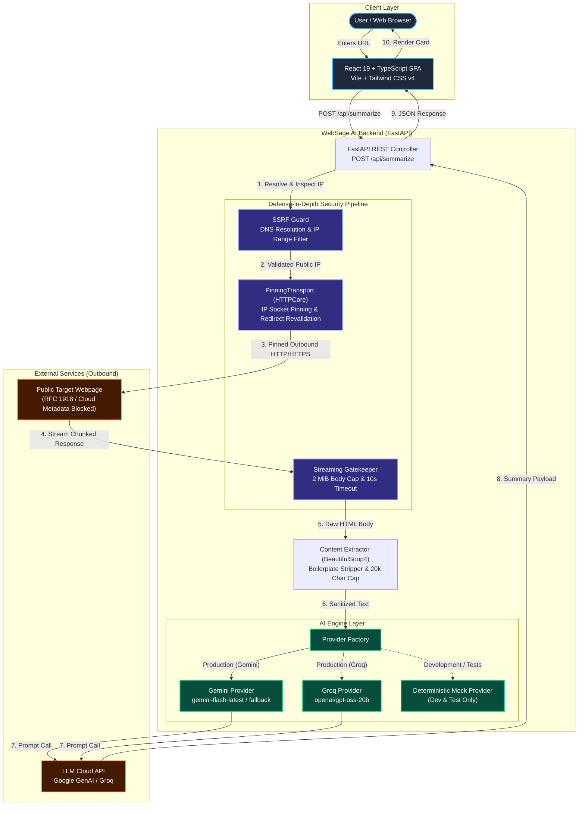
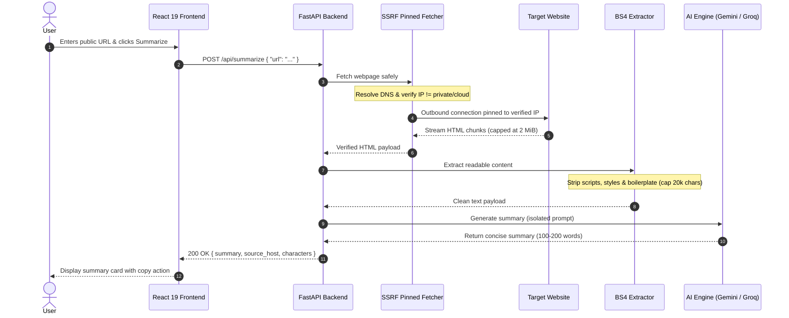

<div align="center">


# WebSage AI
### High-Speed, Security-Hardened Webpage Summarizer

[](LICENSE)
[](https://www.python.org/)
[](https://fastapi.tiangolo.com/)
[](https://react.dev/)
[](https://www.typescriptlang.org/)
[](https://vitejs.dev/)
[](https://tailwindcss.com/)
[](https://ai.google.dev/)
[](#automated-testing-and-verification)
[](#zero-cost-budget-guarantee)

<p align="center">
  <b>Transform long articles, documentation pages, and news reports into concise, objective syntheses in seconds.</b><br/>
  Engineered with defense-in-depth SSRF protection, DNS rebinding socket pinning, and strict resource limits.
</p>


[Live Application](https://web-sage-ai.vercel.app/) • [API Documentation](https://websage-ai.onrender.com/docs) • [Architecture Specs](docs/requirements.md) • [Security Policy](SECURITY.md)

</div>

---

## Table of Contents

| | |
| :--- | :--- |
| 1. [Overview](#overview) | 9. [Local Installation & Setup](#local-installation-and-setup) |
| 2. [Key Features](#key-features) | 10. [Running the Application](#running-the-application) |
| 3. [Live Deployments](#live-deployments) | 11. [Automated Testing & Verification](#automated-testing-and-verification) |
| 4. [System Architecture](#system-architecture) | 12. [API Specifications](#api-specifications) |
| 5. [Security Engineering Baseline](#security-engineering-baseline) | 13. [Deployment Guide](#deployment-guide) |
| 6. [Zero-Cost Budget Guarantee](#zero-cost-budget-guarantee) | 14. [Contributing](#contributing) |
| 7. [Tech Stack](#tech-stack) | 15. [License](#license) |
| 8. [Repository Structure](#repository-structure) | 16. [Author & Contact](#author--contact) |

---

## Overview

Reading entire documentation manuals or news articles to extract a few key takeaways is time-consuming. Most web pages contain boilerplate navigation layouts, ads, tracking scripts, and peripheral noise that obscure the primary content.

**WebSage AI** provides a security-first summarization pipeline:

1. **Validates and Pins Outbound Traffic:** Blocks SSRF attempts and binds connections to pre-verified public IP addresses.
2. **Extracts and Purifies Content:** Parses HTML documents, discards boilerplate and scripts, and caps readable text at 20,000 characters.
3. **AI Synthesis:** Passes clean article content to an isolated LLM inference prompt (Google Gemini or Groq) to deliver high-density, factual summaries in seconds.

---

## Key Features

- **Hardened SSRF Protection:** Pre-request DNS resolution rejecting RFC 1918 private subnets, loopbacks, link-local cloud metadata (`169.254.169.254`), multicast, and CGNAT (`100.64.0.0/10`).
- **DNS Rebinding (TOCTOU) Defense:** Custom socket pinning (`PinningTransport`) binds the outbound TCP socket directly to the pre-validated public IP address, preventing DNS rebinding race attacks.
- **Streaming Safety Cap:** Hard limits downloads to 2 MiB, terminating connections mid-stream if oversized to prevent memory exhaustion and decompression bombs.
- **Controlled Redirect Traversal:** Enforces a maximum of 3 redirect hops, re-validating the destination IP before opening each new connection.
- **Content Boilerplate Stripper:** BeautifulSoup4 parser strips `<nav>`, `<header>`, `<footer>`, `<aside>`, `<script>`, `<style>`, and tracker tags.
- **Multi-Provider AI Architecture:** First-class support for Google Gemini (`gemini-flash-latest`, `gemini-flash-lite-latest`) and Groq (`openai/gpt-oss-20b`), with an offline deterministic mock provider for zero-cost development.
- **Refined Dark Interface:** Modern React 19 single-page application built with TypeScript, Tailwind CSS v4, Lucide icons, keyboard shortcuts, and one-click clipboard copying.

---

## Live Deployments

| Component | URL | Platform | Status |
| :--- | :--- | :--- | :--- |
| **Frontend Application** | [https://web-sage-ai.vercel.app/](https://web-sage-ai.vercel.app/) | Vercel | Active |
| **Backend REST API** | [https://websage-ai.onrender.com](https://websage-ai.onrender.com) | Render | Active |
| **API Health Check** | [https://websage-ai.onrender.com/health](https://websage-ai.onrender.com/health) | Render | Active |
| **Interactive Swagger Docs** | [https://websage-ai.onrender.com/docs](https://websage-ai.onrender.com/docs) | Render | Active |

---

## System Architecture

### Component Architecture



---

### Request Execution Flow



---

## Security Engineering Baseline

Web-crawling applications are intrinsically exposed to server-side network traversal vulnerabilities. WebSage AI enforces strict controls at every stage:

| Threat Vector | Attack Scenario | WebSage AI Defense |
| :--- | :--- | :--- |
| **SSRF (Internal Network)** | Target URL points to `192.168.1.1` or `10.0.0.1` | **Rejected.** DNS pre-resolution verifies all resolved IPs against `ipaddress.is_global`. |
| **Cloud Metadata Theft** | Attacker probes `http://169.254.169.254/latest/meta-data` | **Rejected.** Link-local addresses (`169.254.0.0/16`) are blocked before socket creation. |
| **DNS Rebinding (TOCTOU)** | Domain resolves to public IP on initial check, but switches to `127.0.0.1` on connect | **Mitigated.** `PinningTransport` pins the socket directly to the validated IP, preserving SNI and TLS validation. |
| **Redirect Poisoning** | Public URL issues a `302 Redirect` to internal address space | **Mitigated.** Automatic redirects are disabled. Destinations are re-validated at each hop (maximum 3). |
| **Decompression Bomb** | Server returns an infinite or multi-gigabyte body | **Mitigated.** Streaming reader enforces a hard **2 MiB cap** and terminates the connection immediately. |
| **Prompt Injection** | Scraped page contains malicious instructions (e.g. *"Ignore previous instructions..."*) | **Mitigated.** Content is isolated within explicit structural tags; system prompt instructs LLM to treat scraped content strictly as untrusted data. |
| **Credential Leakage** | API keys or server stack traces exposed in logs or responses | **Mitigated.** Strict exception sanitization; API keys reside exclusively in backend environment memory. |

---

## Zero-Cost Budget Guarantee

WebSage AI is engineered to operate continuously at **zero mandatory financial cost**:

- **AI Inference:** Google Gemini API free tier or Groq Cloud free tier (`openai/gpt-oss-20b`).
- **Backend Hosting:** Render Free Web Services (750 free instance hours per month).
- **Frontend Hosting:** Vercel Hobby Tier or Cloudflare Pages (100 GB bandwidth per month).
- **Development and CI:** Fully functional offline mode using `USE_MOCK_AI=true` for zero token consumption.

---

## Tech Stack

### Backend
- **Python 3.10+** (Asynchronous runtime)
- **FastAPI** (REST framework with automated OpenAPI documentation)
- **Pydantic v2 and Pydantic-Settings** (Strict request and environment validation)
- **HTTPX and HTTPCore** (Async HTTP client with custom socket pinning)
- **BeautifulSoup4** (HTML sanitization and text extraction)
- **Google GenAI SDK** (`google-genai` for Gemini inference)
- **Groq SDK** (LPU inference engine)
- **Pytest and Pytest-Asyncio** (Automated test suite)

### Frontend
- **React 19** (Concurrent UI library)
- **TypeScript 5** (Strict type safety)
- **Vite 6** (Frontend build tooling and bundler)
- **Tailwind CSS v4** (Utility-first styling with modern dark theme)
- **Lucide React** (Accessible SVG iconography)

---

## Repository Structure

```text
WebSage-AI/
├── .gitignore                      # Git exclusion rules
├── CODE_OF_CONDUCT.md              # Contributor Covenant v2.1
├── CONTRIBUTING.md                  # Development guidelines & PR process
├── LICENSE                         # MIT License
├── README.md                       # Project documentation
├── SECURITY.md                     # Vulnerability reporting procedure
│
├── docs/                           # Specifications
│   ├── acceptance-criteria.md      # Acceptance criteria verification
│   ├── requirements.md             # Functional requirements & API spec
│   └── security.md                 # Security baseline & threat models
│
├── backend/                        # FastAPI Backend Application
│   ├── .env.example                # Configuration template
│   ├── pytest.ini                  # Pytest configuration
│   ├── requirements.txt            # Python dependencies
│   ├── app/
│   │   ├── __init__.py
│   │   ├── config.py               # Application settings
│   │   ├── main.py                 # FastAPI application routes & middleware
│   │   ├── models.py               # Pydantic schemas (Request/Response/Errors)
│   │   └── services/
│   │       ├── extractor.py        # BeautifulSoup4 HTML text parser
│   │       ├── fetcher.py          # SSRF-hardened pinned HTTPX fetcher
│   │       └── ai/
│   │           ├── base.py         # Abstract AI provider interface
│   │           ├── factory.py      # Provider factory with production guard
│   │           ├── gemini_provider.py # Google Gemini SDK implementation
│   │           ├── groq_provider.py# Groq SDK implementation
│   │           └── mock_provider.py# Deterministic offline mock provider
│   └── tests/                      # Automated Test Suite (35 tests)
│       ├── conftest.py             # Pytest fixtures & async setup
│       ├── test_ai_provider.py     # AI provider tests (mock, Groq, Gemini)
│       ├── test_api_e2e.py         # End-to-end FastAPI endpoint tests
│       ├── test_extractor.py       # HTML parsing & truncation tests
│       ├── test_ssrf_fetcher.py    # SSRF & connection pinning tests
│       └── test_validation.py      # URL & IP validation tests
│
└── frontend/                       # React 19 Frontend Application
    ├── index.html                  # HTML entry point
    ├── package.json                # Dependencies & scripts
    ├── tsconfig.json               # TypeScript configuration
    ├── vite.config.ts              # Vite configuration & dev proxy
    └── src/
        ├── App.tsx                 # Root application component
        ├── main.tsx                # React entry point
        ├── index.css               # Tailwind CSS setup & global styles
        ├── components/
        │   ├── Header.tsx          # Navigation header & repository link
        │   ├── UrlForm.tsx         # URL input form with validation
        │   ├── SummaryCard.tsx     # Result display with clipboard copy
        │   └── ErrorBanner.tsx     # Sanitized error notifications
        └── services/
            └── api.ts              # Typed API client
```

---

## Local Installation and Setup

### Prerequisites
- **Python:** Version `3.10` or higher
- **Node.js:** Version `18.0` or higher and **npm** `9.0`+
- **Git:** Version `2.x`

### 1. Clone the Repository
```bash
git clone https://github.com/shlok926/WebSage-AI.git
cd WebSage-AI
```

### 2. Backend Setup
```bash
cd backend

# Create virtual environment
python -m venv venv

# Activate virtual environment
# Windows:
venv\Scripts\activate
# Linux/macOS:
source venv/bin/activate

# Install dependencies
pip install -r requirements.txt

# Create environment file from template
# Windows (PowerShell):
Copy-Item .env.example .env
# Linux/macOS:
cp .env.example .env
```

### 3. AI Provider Configuration (`backend/.env`)

Configure your preferred AI provider in `backend/.env`:

#### Option A: Google Gemini
```env
AI_PROVIDER=gemini
GEMINI_API_KEY=your_actual_gemini_api_key_here
GEMINI_MODEL=gemini-flash-latest
USE_MOCK_AI=false
```

#### Option B: Groq
```env
AI_PROVIDER=groq
GROQ_API_KEY=your_actual_groq_api_key_here
GROQ_MODEL=openai/gpt-oss-20b
USE_MOCK_AI=false
```

#### Option C: Offline Mock Mode
```env
USE_MOCK_AI=true
```
Enables full local testing of the scraping and frontend pipeline without external API credentials.

### 4. Frontend Setup
```bash
cd ../frontend
npm install
```

---

## Running the Application

### 1. Launch Backend Server
```bash
cd backend
python -m uvicorn app.main:app --host 127.0.0.1 --port 8000 --reload
```
- **API Server:** `http://127.0.0.1:8000`
- **Swagger Documentation:** `http://127.0.0.1:8000/docs`
- **Health Check:** `http://127.0.0.1:8000/health`

### 2. Launch Frontend Development Server
```bash
cd frontend
npm run dev
```
- **Application UI:** `http://localhost:5173`
- Vite proxies `/api` and `/health` requests to the local backend automatically.

---

## Automated Testing and Verification

The test suite includes 35 comprehensive automated tests covering security invariants, content parsing, and provider error handling:

```bash
# Run backend test suite from repository root
python -m pytest backend/tests -v -c backend/pytest.ini
```

```text
======================= 35 passed in 3.95s =======================
```

To verify the frontend TypeScript types and production build:
```bash
cd frontend
npm run build
```

---

## API Specifications

### `POST /api/summarize`
Summarizes an accessible public webpage.

#### Request Body
```json
{
  "url": "https://en.wikipedia.org/wiki/Artificial_intelligence"
}
```

#### Success Response (`200 OK`)
```json
{
  "summary": "Artificial intelligence (AI) is the intelligence of machines or software, as opposed to the intelligence of humans or animals. It is a field of study in computer science that develops and studies intelligent machines...",
  "source_url": "https://en.wikipedia.org/wiki/Artificial_intelligence",
  "source_host": "en.wikipedia.org",
  "extracted_characters": 18450
}
```

#### Error Response (`4xx / 5xx`)
```json
{
  "error": {
    "code": "SSRF_BLOCKED",
    "message": "Access to private, loopback, or internal network destinations is prohibited."
  }
}
```

#### Error Code Reference
| Status Code | Error Code | Description |
| :--- | :--- | :--- |
| `200 OK` | — | Webpage extracted and summarized successfully. |
| `400 Bad Request` | `INVALID_URL` | Malformed URL, missing scheme, or credentials present. |
| `400 Bad Request` | `SSRF_BLOCKED` | Host resolves to private, loopback, or internal address space. |
| `413 Payload Too Large` | `PAYLOAD_TOO_LARGE` | Streamed HTML exceeded the 2 MiB safety limit. |
| `415 Unsupported Media` | `UNSUPPORTED_CONTENT`| Response is not HTML (e.g. PDF, binary, audio). |
| `422 Unprocessable` | `INSUFFICIENT_CONTENT`| Extracted readable text is fewer than 50 characters. |
| `429 Too Many Requests` | `RATE_LIMIT_EXCEEDED`| Upstream AI provider rate limit reached. |
| `502 Bad Gateway` | `UPSTREAM_ERROR` | Target website returned an error or AI provider failed. |
| `504 Gateway Timeout` | `UPSTREAM_TIMEOUT` | Web fetch (>10s) or AI inference (>30s) timed out. |

---

## Deployment Guide

### Backend on Render (Web Service)
1. In the [Render Dashboard](https://dashboard.render.com/), select **New +** → **Web Service**.
2. Connect the `WebSage-AI` repository.
3. Configure service parameters:
   - **Root Directory:** `backend`
   - **Runtime:** `Python 3`
   - **Build Command:** `pip install -r requirements.txt`
   - **Start Command:** `uvicorn app.main:app --host 0.0.0.0 --port $PORT`
   - **Instance Type:** `Free`
4. Set Environment Variables:
   - `ENVIRONMENT`: `production`
   - `AI_PROVIDER`: `gemini`
   - `GEMINI_API_KEY`: `<your_gemini_api_key>`
   - `GEMINI_MODEL`: `gemini-flash-latest`
   - `USE_MOCK_AI`: `false`
   - `CORS_ORIGINS`: `*`
   - `PYTHON_VERSION`: `3.11.9`

### Frontend on Vercel
1. In [Vercel](https://vercel.com/), select **Add New...** → **Project** and import `WebSage-AI`.
2. Select **Import single project** for the `frontend` folder.
3. Verify settings:
   - **Framework Preset:** `Vite`
   - **Root Directory:** `frontend`
   - **Build Command:** `npm run build`
   - **Output Directory:** `dist`
4. Set Environment Variable:
   - `VITE_API_BASE_URL`: `https://websage-ai.onrender.com`

---

## Contributing

Review the project guidelines before opening an issue or pull request:
- **[CONTRIBUTING.md](CONTRIBUTING.md)**: Development workflow, coding standards, and PR guidelines.
- **[CODE_OF_CONDUCT.md](CODE_OF_CONDUCT.md)**: Community standards and participant expectations.
- **[SECURITY.md](SECURITY.md)**: Vulnerability disclosure policies and procedures.

---

## License

This project is licensed under the **MIT License**. See the [LICENSE](LICENSE) file for details.

---

## Author & Contact

<div align="center">

### Shlok Thorat
*Let's connect on LinkedIn, collaborate, and build amazing things together!*

[](mailto:shlokthorat29075@gmail.com)
[](https://github.com/shlok926)
[](https://linkedin.com/in/shlok-thorat-39916a405)

<br/>

Made by Shlok! for Cybersecurity Innovation • [Back to Top](#websage-ai)

</div>
